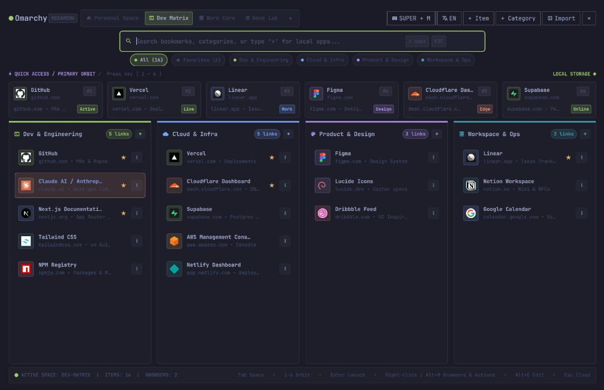

# Omarchy Megamenu (`gruut.megamenu`)

A theme-aware Spotlight-style megamenu and bar widget for [Omarchy](https://omarchy.org/) featuring workspaces (**Spaces**), a 6-slot **Quick Access Orbit**, color-coded categories, live **RSS/Atom & GitHub columns**, web bookmarks with automatic favicons, built-in **Omarchy system actions & desktop app search**, saved **shell commands**, per-link browser selection, one-click browser bookmark importing, and a [Firefox / Zen add-on](https://addons.mozilla.org/firefox/addon/omarchy-megamenu/) to save the current page.

Guide: [megamenu.rovix.eu](https://megamenu.rovix.eu)



## Features

- **Spaces (Workspaces for Links, Feeds & Apps):**
  - Organize your links, feeds, and apps into separate spaces (e.g. *Dev Matrix*, *Homelab & Infra*, *Live Pulse*, *Personal*) and switch between them with `Tab` / `Shift+Tab` or a click.
  - Create, rename, or delete spaces directly from the top bar.
- **Quick Access / Primary Orbit (`1–6`):**
  - Pin up to 6 of your most used web apps, Omarchy actions, local applications, or shell commands per space and launch them instantly with keys `1` through `6`.
- **Live Columns (RSS/Atom & GitHub Issues/PRs/Releases):**
  - Any category column can be configured as a **Static Bookmark list**, **RSS / Atom Feed**, or **GitHub Repository feed** (`owner/repo` or `@me` via `gh` CLI).
  - Includes a built-in **Live Pulse** showcase space (Hacker News, Omarchy GitHub activity, Tech News) and one-click `󰐃` pinning to save any live entry as a permanent bookmark.
- **Color-Coded Categories & Theme Integration:**
  - Automatically adapts to the active Omarchy light/dark theme (`Color`, `Style`, `Border`, and semantic ANSI colors from `colors.toml`: `blue`, `cyan`, `green`, `magenta`, `yellow`, `orange`, `red`).
  - Responsive category filter badges under the search bar that center on a single row and wrap cleanly when you have many categories.
- **Instant Search, Omarchy Spotlight Actions & Local App Launcher (`>`):**
  - Type anywhere to filter bookmarks and commands across **all Spaces** (matches from other spaces appear in dedicated columns) **and** simultaneously search native Omarchy system actions (`Style › Theme`, `Style › Background`, `System › Lock`, `Trigger › Capture › Screenshot`, `Setup › Monitors`, etc.) and installed `.desktop` applications.
  - Prefix your query with **`>`** (e.g. `> theme`, `> ghostty`, `> restic`) to open the dedicated full-width Omarchy actions, applications, and saved-commands view, or pin any action/app into a Megamenu category.
- **Frequent launches:**
  - Opening Megamenu with an empty search shows a **Frequent** strip of your most-used bookmarks, apps, and commands (ranked by launch count).
- **Shell commands:**
  - Add a command from the item dialog (`Ctrl+N`, then **Command**) into any category. Optional working directory, Orbit pin, and glyph icon work the same way as other items.
  - **Terminal** (default) opens the default Omarchy terminal via `xdg-terminal-exec`, runs the command with `bash -lc`, and waits for a key after it finishes. **Background** runs the same script with no window.
  - Find a saved command by its title or command text, including from `>`.
- **Notes (Markdown on disk):**
  - A **Note** space with a note list on the left and a plain-Markdown editor on the right. Pick one folder where new notes are written, and attach more folders whose existing `.md` files are listed. A pin on the card keeps that note at the top. Notes are ordinary files, not copies inside `data.json`. See [Notes](#notes).
- **Reorder & Move Between Spaces:**
  - Hover ▲ / ▼ on a static bookmark to reorder it within its category (hidden while searching or filtering Favorites).
  - Move an item to another space and category from the edit modal or the context menu (**Move to…** → Space → category). Orbit pins clear when the space changes.
- **Right-Click Browser Chooser & Actions:**
  - Right-click any item (or press `Alt+M`) to open a context menu where you can launch a URL in **any installed browser** (Brave, Zen, Firefox, Chromium, Vivaldi, LibreWolf, etc.), copy the URL, Desktop ID, or command to the clipboard (`wl-copy`), edit, move, or delete the item.
- **Browser Bookmark Importer:**
  - Automatically detects bookmark profiles from installed Chromium-based browsers (Brave, Chromium, Chrome, Vivaldi, Edge) and Firefox/Zen/LibreWolf (`places.sqlite`), as well as exported HTML files (`~/Downloads/bookmarks.html`).
  - Select which bookmark folders to import as color-coded categories into the active space.
- **Save the current page (Firefox / Zen / Chrome):**
  - Install the [Omarchy Megamenu](https://addons.mozilla.org/firefox/addon/omarchy-megamenu/) add-on in Firefox or Zen (Chrome can load `extension/` unpacked), then enable **Page save** in Megamenu so the local native-messaging helper can write bookmarks.
  - The toolbar popup picks a space and category (**Seznam čtení** is seeded automatically). Megamenu reloads `data.json` the next time it opens.
- **Opt-In Global Keyboard Shortcut (Spotlight Mode):**
  - Click the **`󰌌 Set shortcut`** button in the top bar of Megamenu to optionally bind a Hyprland shortcut (such as `SUPER + M` or `ALT + SPACE`) in `~/.config/hypr/bindings.lua` using Omaplug-compatible comment blocks.
  - Strictly opt-in: no user configuration files are modified without explicit user action.
  - The same dialog has a separate, optional row for a **new note** shortcut (suggested `SUPER + N`). It is off by default and is only written after you turn it on there.
- **Multilingual UI (English & Czech):**
  - Supports automatic locale detection (`Auto`), **English (`EN`)**, and **Czech (`CS`)**, switchable from the **▾** menu or via bar widget settings.

## Install

```bash
omarchy plugin add https://github.com/Morganczech/omarchy-megamenu --enable
```

## Update & Remove

If you configured an optional global keyboard shortcut inside Megamenu, you can disable it first via the **`󰌌`** button (**Disable shortcut**) before removing the plugin.

```bash
# Update plugin
omarchy plugin update gruut.megamenu

# Move widget to another bar section
omarchy bar move gruut.megamenu --section left

# Remove plugin
omarchy plugin remove gruut.megamenu
```

### Manual removal

```bash
rm -rf ~/.config/omarchy/plugins/gruut.megamenu
```

Then remove `"gruut.megamenu"` from `~/.config/omarchy/shell.json` (and any optional `-- omaplug-shortcut-start: gruut.megamenu` block from `~/.config/hypr/bindings.lua`) and run `omarchy restart shell`.

## Usage

Click the **Megamenu** icon (`󰀻`) in the Omarchy bar, or toggle it from a terminal / keybinding:

```bash
omarchy-shell shell toggle gruut.megamenu
```

### Keyboard Shortcuts inside Megamenu

| Key | Action |
| --- | --- |
| **Type text** | Filter bookmarks and commands across all Spaces (plus Omarchy actions / apps) |
| **`>` + query** | Search and launch Omarchy actions, installed applications, and saved commands |
| **`1` – `6`** | Launch pinned Quick Access Orbit slot `1–6` (when search is empty; the Note space does not use these keys) |
| **`Tab` / `Shift+Tab`** | Switch to next / previous Space |
| **`↑` / `↓` / `←` / `→`** | Navigate items (or system apps in `>` mode) |
| **`Enter`** | Launch selected bookmark, command, or application |
| **`Right-Click` / `Alt+M`** | Open context menu (choose browser, copy URL, edit, delete) |
| **`Alt+E`** | Edit selected item |
| **`Ctrl+N`** | Add new bookmark, command, or local application (in the Note space: start a new note) |
| **`Ctrl+S`** | Save the open note (Note space, editor focused) |
| **`SUPER + N`** | Optional, off by default. Opens the Note space with a new note. Turn it on from the shortcut dialog; it is not a default binding |
| **`Esc`** | Close modal / context menu / Megamenu |

### Save the current page

Two pieces are required: the **browser extension** (saves the tab) and the **local native-messaging host** (writes into Megamenu’s `data.json`). Neither works alone.

#### 1. Install the extension

- **Firefox / Zen (recommended):** [Omarchy Megamenu on Mozilla Add-ons](https://addons.mozilla.org/firefox/addon/omarchy-megamenu/)  
  Czech listing: [addons.mozilla.org/cs/…](https://addons.mozilla.org/cs/firefox/addon/omarchy-megamenu/)
- **Temporary / unpacked (dev):** load `extension/manifest.json` via `about:debugging` → This Firefox → Load Temporary Add-on
- **Chrome / Chromium / Brave:** `chrome://extensions` → Developer mode → Load unpacked → `extension/`

#### 2. Register the local helper

Open Megamenu and click **Page save** / **Ukládání stránek** in the **▾** menu (hover explains that the add-on is still required). Or from a terminal:

```bash
python3 ~/.config/omarchy/plugins/gruut.megamenu/scripts/install-browser-host.py --firefox-only
```

From this checkout:

```bash
python3 scripts/install-browser-host.py --firefox-only
```

When the button shows **Page save on** / **Ukládání zapnuto**, Firefox and Zen can talk to `scripts/native-host.py`.

#### Using it

The toolbar button shows the page title, then a space (**Seznam čtení** first) and a category. Saving the same URL into the same space again does not create a duplicate. Favicons are fetched the next time Megamenu opens.

`python3 scripts/install-browser-host.py --remove` deletes the host registration. It does not remove the extension from the browser.

### Add a shell command

Megamenu stores the command text in your menu data. It does not create or keep a script file for you. Type a short command directly, or point at a script you have already saved.

1. Open Megamenu and press **`Ctrl+N`** (or **+ Item**).
2. Choose **Command**. In the Czech interface the button is **Příkaz**.
3. **Title** is the label shown in the menu, for example `Restic Backup`.
4. **Command** is what actually runs:
   - the name of a program already available in the terminal, such as `restic-backup`
   - or a single line, such as `notify-send "Backup finished"`
5. **Working directory** is optional. Set it when the command has to start inside a project, for example `pnpm dev` in `~/Work/my-app`.
6. Choose how it runs:
   - **Terminal** opens your usual terminal, runs the command, and keeps the window open until you press a key. Use this when you want to read the output.
   - **Background** runs the command with no window. Use this when there is nothing to read, such as a notification.
7. Pick a category. You can also pin an Orbit slot (`1`–`6`) and set an icon.
8. Save the item.

Click the item, press **Enter**, or press its Orbit key. You can also type **`>`** and part of the name, for example `> restic`. Right-click the item to copy the command text, edit it, or delete it.

A longer script is an ordinary file you save yourself, usually under `~/.local/bin/`, with the executable bit set. Megamenu then only needs that file's name in the **Command** field. `~/.local/bin` is on the terminal `PATH` in Omarchy, so the name alone is enough.

You can also ask an assistant in Omarchy to prepare the script and add the menu item. For a backup, the script file should contain the backup itself. Megamenu already keeps the terminal window open when **Terminal** is selected, so the script does not need its own "press a key" ending.

The assistant saves the file, marks it executable, then adds the menu entry. Close Megamenu before that write. Open it again afterwards.

```bash
install -m 755 ./restic-backup ~/.local/bin/restic-backup

python3 ~/.config/omarchy/plugins/gruut.megamenu/scripts/add-command.py \
  --title "Restic Backup" \
  --command restic-backup \
  --space "Home Lab" \
  --category General \
  --run terminal \
  --slot 3
```

`--space` and `--category` match the names you see in Megamenu. The same command and space are updated instead of added twice. `--run background` is the no-window choice. `--slot 0` leaves the Orbit pin unset.

## Notes

The **Note** space keeps your own notes as plain Markdown files.

- **Write folder:** pick the one folder where new notes are created. Open the **Folders** control in the note list header and set it there.
- **More folders:** attach extra folders in the same control. Their existing `.md` files (including nested ones, but not hidden directories) are listed; new files are never created there.
- **Edit plain Markdown:** the right pane is a plain text editor. A line such as `# Nadpis` is kept in the file, and the file is named after the title (`Nadpis.md`). YAML frontmatter at the top of a file is preserved and not shown in the editor. `Ctrl+S` saves, and leaving a note that has text saves it too. An empty draft creates no file.
- **Pin a note:** the pin icon on a note card keeps that note above the others. The most recently pinned note is first. Click the pin again to unpin. The icon is colored while the note is pinned. Keys `1`–`6` do not open notes.
- **Categories:** note categories use the same filter row under the search field as other spaces. Badges stay on the cards.
- **Find a note:** typing in any space also matches note titles, file names, and badges. Choosing a match opens it in the Note space.
- **Omawrite opens the file:** **Open in Omawrite** in the editor, or the same action in the note's context menu, edits that file outside the menu. When you come back, a note without unsaved edits reloads; with unsaved text, your text is kept and a notice says the file changed.
- **Delete moves the file to trash:** after a confirmation the file goes to the system trash, so it can be restored. Cancel leaves it alone.
- **`SUPER + N` is opt-in:** open the shortcut dialog from the top bar and turn on the note shortcut row. Nothing is written to `bindings.lua` until you do. It opens a new note even when Megamenu is already open.
- **Top-bar `▾` menu:** the top row shows shortcut, add item, add category, close, and `▾`. **Page save**, language, and import are inside the `▾` menu, in every space.

Notes are files you own. Removing the plugin does not delete them.

## Requirements & Dependencies

- **Omarchy 4.x** (`quickshell` runtime, Hyprland, and `omarchy` CLI)
- **Standard system utilities included with Omarchy:**
  - `python3` (standard library `sqlite3`, `json`, `html.parser` for bookmark importing, opt-in shortcut management, and the browser save host)
  - `curl` (caches website favicons into `~/.local/share/omarchy-megamenu/favicons/`)
  - `wl-copy` (copies URLs and Desktop IDs to the Wayland clipboard)
  - `xdg-open` and `gtk-launch` (launches URLs and `.desktop` applications)
  - `xdg-terminal-exec` (opens the default terminal for saved commands)
- **Data storage:** Bookmarks, categories, and saved commands stay on this computer in `~/.local/share/omarchy-megamenu/data.json`.

## License

[MIT](LICENSE) © 2026 Morganczech
